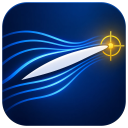

# AViSta

**AViSta** is a free, open-source desktop program for flight-vehicle simulation: computational fluid dynamics (CFD), stability derivatives and, later, shape optimization. You set up a case through physical concepts (walls, far-field, flight condition, turbulence model), never through solver files or a command line, and the program explains the science as you go.

This repository holds the **installers and release notes**. The source code lives in a separate repository and will be published when the project goes public.

## Status: preview

AViSta is in early preview. What works today:

- Open an SU2 mesh and see it in 3D; mark walls, far-field and symmetry planes.
- Set the flight condition (altitude or pressure and temperature, Mach number or speed, angle of attack and sideslip), the reference values and the flow model: inviscid, laminar, Spalart–Allmaras or k-ω SST.
- Run SU2 from the program, watch the residuals converge, stop and continue.
- Read lift, drag, side force and moments, as coefficients or in newtons, and save or reopen the case.

Coming next: OpenFOAM as a second solver, more mesh formats, guided CFD lessons (Learn), and adjoint stability derivatives.

## Download and install (Windows 10 or 11, 64-bit)

1. Open [Releases](../../releases) and download the latest installer.
2. Run it. AViSta installs for your user only and does not need administrator rights. The SU2 solver comes with it, so nothing else needs to be installed.
3. **Windows may warn that it "protected your PC"**, because preview builds are not signed yet. Click **More info**, then **Run anyway**.

## Download and run (Linux, 64-bit)

1. Open [Releases](../../releases) and download the `.AppImage` file. It is the whole program in one file, SU2 included, and needs no administrator password. It runs on Ubuntu 22.04 or newer and on other distributions from 2022 on.
2. In your file manager, right-click it → **Properties** → **Permissions**, and tick **Allow executing file as program**.
3. Double-click it.

On Linux, SU2 runs on one processor core in this preview; several cores are coming next.

## Reporting a problem

Please open an [issue](../../issues) with what you did, what you expected, and what happened. **Help → About AViSta** shows the version to mention. If AViSta shows "Something went wrong", copy the details from that window into the issue.

## License

AViSta is open-source software under the MIT license. It ships with third-party software under its own licenses (Qt and PySide6, VTK, NumPy, Matplotlib, SU2 and others); their texts are in the `licenses` folder of the installed program and listed in **Help → About AViSta**.
